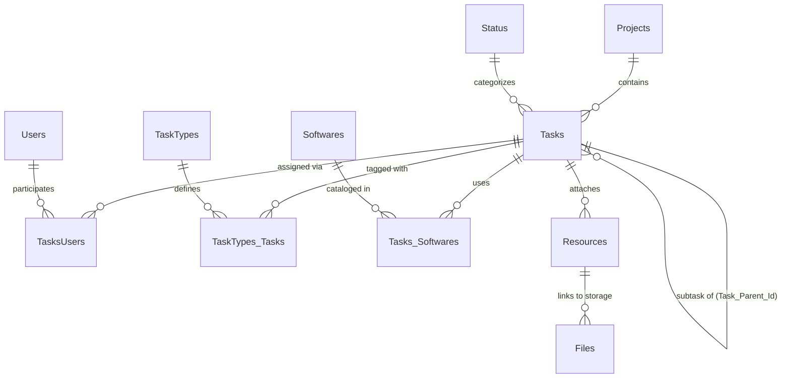

# TaskMaster 🚀

A production-ready, high-performance single-page task management and Kanban application built with **Next.js 14 (App Router)**, **TypeScript**, **Tailwind CSS**, and **Supabase (PostgreSQL, Storage, & RLS)**.

TaskMaster is designed for high-velocity teams and creative studios — featuring hierarchical subtasks, deep folder navigation, software stack tagging (with transparent PNG/SVG icons), deadline alerts, and seamless offline/demo resilience.

---

## 📑 Table of Contents

- [Features](#-features)
- [Tech Stack](#-tech-stack)
- [Prerequisites](#-prerequisites)
- [Step-by-Step Local Setup](#-step-by-step-local-setup)
  - [1. Clone the Repository](#1-clone-the-repository)
  - [2. Install Dependencies](#2-install-dependencies)
  - [3. Supabase Project Setup](#3-supabase-project-setup)
  - [4. Execute Database Schema & Storage Setup](#4-execute-database-schema--storage-setup)
  - [5. Configure Environment Variables](#5-configure-environment-variables)
  - [6. Start the Development Server](#6-start-the-development-server)
- [Demo Mode vs. Live Supabase Mode](#-demo-mode-vs-live-supabase-mode)
- [Available npm Scripts](#-available-npm-scripts)
- [Database Schema & Architecture](#-database-schema--architecture)
- [Project Directory Structure](#-project-directory-structure)
- [Troubleshooting & FAQs](#-troubleshooting--faqs)

---

## ✨ Features

- 📋 **Kanban Board with Drag & Drop**: Smooth, collision-detected card movement powered by `@dnd-kit` with instant optimistic UI updates.
- 🎨 **Column Customization**: Add, rename, reorder, or recolor columns with a 16-color palette or custom hex picker.
- 📂 **Hierarchical Tasks & Folder Explorer**:
  - Subtasks are full-fledged tasks that can have their own assignees, types, deadline dates, and child subtasks.
  - Interactive directory tree explorer with breadcrumbs (`📁 Project / 📁 Task / 📄 Subtask`) and instant jump navigation.
- 💻 **Software Tagging & Visual Stack**:
  - Tag tasks with software tools used in production (e.g., Blender, Figma, Photoshop, Unreal Engine, VS Code).
  - Multi-column icon stack on Kanban cards with transparency grid preview.
  - Software manager modal with transparent PNG/JPG/SVG upload support and delete confirmation.
- ⏰ **Deadline Tracking & Overdue Badging**:
  - Track **Date Posted** (`created_at`), **Date Edited** (`updated_at`), and **Deadline** (`due_date`).
  - Automatic red warning tags when a task deadline has passed.
- 🔗 **Deep Linking & URL Routing**:
  - Open and share tasks directly via URL parameters (e.g. `http://localhost:3000/?task=<id>`).
  - Supports browser Back / Forward history navigation and persistent project selection.
- 🌓 **Dark & Light Mode**: Instant theme switching with clean contrast and persistent local storage preference.
- 📎 **Drag-and-Drop File Uploads**: Upload attachments directly to Supabase Storage with preview and download links.

---

## 🛠 Tech Stack

- **Framework**: [Next.js 14](https://nextjs.org/) (App Router, Server Actions, React Server Components)
- **Language**: [TypeScript](https://www.typescriptlang.org/) (Strict type checking)
- **Backend / Database**: [Supabase](https://supabase.com/) (PostgreSQL 15, Row Level Security, Storage)
- **Styling**: [Tailwind CSS](https://tailwindcss.com/)
- **UI Components**: [shadcn/ui](https://ui.shadcn.com/) / [Radix UI](https://www.radix-ui.com/)
- **Drag & Drop**: [`@dnd-kit/core`](https://dndkit.com/), `@dnd-kit/sortable`
- **Icons**: [Lucide React](https://lucide.dev/)

---

## 📦 Prerequisites

Before running the application locally, ensure you have the following installed:

1. **Node.js**: `v18.17.0` or higher (Node `v20.x` LTS recommended).  
   Verify by running:
   ```bash
   node -v
   ```
2. **npm** (comes with Node.js) or **pnpm** / **yarn**:
   ```bash
   npm -v
   ```
3. **Git**:
   ```bash
   git --version
   ```
4. **Supabase Account**: A free account at [supabase.com](https://supabase.com/).

---

## 🚀 Step-by-Step Local Setup

### 1. Clone the Repository

Open your terminal or PowerShell and clone the project:

```bash
git clone https://github.com/your-username/TaskMaster.git
cd TaskMaster
```

---

### 2. Install Dependencies

Install all required npm packages:

```bash
npm install
```

> **Windows Note**: If you encounter file lock or permission errors during install, make sure no other terminal is locking the `node_modules` directory and rerun `npm install`.

---

### 3. Supabase Project Setup

1. Log into your [Supabase Dashboard](https://supabase.com/dashboard).
2. Click **"New Project"**.
3. Choose your Organization, enter a **Project Name** (e.g., `TaskMaster`), set a secure **Database Password**, and select the region closest to you.
4. Click **"Create new project"** and wait ~1–2 minutes for the database to provision.

---

### 4. Execute Database Schema & Storage Setup

1. In your Supabase project dashboard, open the **SQL Editor** from the left-hand navigation (icon looks like `>_`).
2. Click **"New query"**.
3. Open the file [`supabase/schema.sql`](supabase/schema.sql) from this repository in your code editor.
4. Copy the entire contents of `supabase/schema.sql`, paste it into the Supabase SQL Editor, and click **Run** (or press `Ctrl` + `Enter`).

#### What this migration executes:
- ✅ **Tables**: `Users`, `Skills`, `UsersSkills`, `Projects`, `Status`, `TaskTypes`, `Tasks`, `TasksUsers`, `TaskTypes_Tasks`, `Resources`, `Files`, `Softwares`, `Tasks_Softwares`.
- ✅ **Foreign Keys & Cascades**: Deleting parent tasks cascades to subtasks, resources, and junction associations.
- ✅ **Indexes**: High-performance indexes on `status_id`, `Project_id`, `Task_Parent_Id`, and junction keys.
- ✅ **Row Level Security (RLS)**: Enables RLS with permissive team access policies.
- ✅ **Storage Bucket**: Creates the `task-attachments` public bucket for file and image uploads.
- ✅ **Default Seed Data**:
  - Statuses: *Backlog*, *To Do*, *In Progress*, *In Review*, *Done*
  - Task Types: *Feature*, *Bug*, *Improvement*, *Design*, *Documentation*
  - Initial Softwares: *Blender*, *Figma*, *Photoshop*, *VS Code*, *Unreal Engine*, *Illustrator*
  - Initial Project: *TaskMaster Sprint 1*

---

### 5. Configure Environment Variables

1. In the root directory of the project, create a new file named `.env.local` by copying `.env.example`:

   **On Windows (PowerShell):**
   ```powershell
   Copy-Item .env.example .env.local
   ```

   **On macOS / Linux:**
   ```bash
   cp .env.example .env.local
   ```

2. Retrieve your Supabase API credentials:
   - In your Supabase Dashboard, go to **Project Settings** (gear icon) &rarr; **API**.
   - Copy the **Project URL** (e.g., `https://xyzcompany.supabase.co`).
   - Copy the **Project API Keys** &rarr; `anon` `public` key.

3. Open `.env.local` and paste your credentials:

   ```env
   NEXT_PUBLIC_SUPABASE_URL=https://your-project-id.supabase.co
   NEXT_PUBLIC_SUPABASE_ANON_KEY=eyJhbGciOiJIUzI1NiIsInR5cCI6IkpXVCJ9...
   ```

> ⚠️ **Important**: Never commit `.env.local` to Git. It is already included in `.gitignore`.

---

### 6. Start the Development Server

Start the Next.js local development server:

```bash
npm run dev
```

Once started, open your web browser and navigate to:
```
http://localhost:3000
```

---

## 💡 Demo Mode vs. Live Supabase Mode

TaskMaster comes with a built-in **zero-config Demo Mode**:

| Feature | Connected Mode (Supabase Configured) | Demo Mode (Missing/Invalid Supabase Keys) |
|---|---|---|
| **Storage** | Persisted directly in PostgreSQL & Supabase Storage | Kept in-memory in server/client session |
| **Realtime** | Fully database-backed | Pre-seeded with interactive tasks, subtasks & softwares |
| **Setup Needed** | Supabase Project + Schema migration | Works immediately out-of-the-box (`npm run dev`) |

If `.env.local` is empty or credentials are not yet configured, the app automatically falls back to **Demo Mode** so you can preview all UI workflows without errors.

---

## 📜 Available npm Scripts

| Command | Description |
|---|---|
| `npm run dev` | Runs the Next.js development server at `http://localhost:3000` with hot-module reloading. |
| `npm run build` | Runs full TypeScript validation and creates an optimized production bundle. |
| `npm run start` | Starts the production server (run `npm run build` first). |
| `npm run lint` | Runs Next.js ESLint checks to enforce code quality. |

---

## 🗄 Database Schema & Architecture

The database follows a relational architecture optimized for speed and recursive hierarchies:



### Key Tables Breakdown

- **`Tasks`**: Primary table containing `id`, `name`, `description`, `status_id`, `Task_Parent_Id` (for infinite nesting), `Project_id`, `position`, `due_date`, `created_at`, `updated_at`.
- **`Softwares`**: Library of software tools with `name` and transparent `icon_url`.
- **`Tasks_Softwares`**: Many-to-many junction table between `Tasks` and `Softwares`.
- **`Status`**: Columns on the Kanban board with `name`, `color`, `position`.
- **`TaskTypes`**: Labels/tags (Bug, Feature, Design, etc.) with custom accent colors.
- **`Resources` & `Files`**: Metadata and URLs pointing to files in the Supabase Storage bucket.

---

## 📁 Project Directory Structure

```text
TaskMaster/
├── public/                 # Static assets
├── src/
│   ├── app/                # Next.js App Router
│   │   ├── globals.css     # Global styles & Tailwind layers
│   │   ├── layout.tsx      # Root HTML structure and theme provider
│   │   └── page.tsx        # Main single-page application & Kanban view
│   ├── components/         # Reusable React UI components
│   │   ├── explorer/       # Hierarchical Folder Tree & Directory view
│   │   ├── kanban/         # KanbanBoard, KanbanColumn, KanbanCard
│   │   ├── layout/         # Header, Project Selector, Theme Toggle
│   │   ├── tasks/          # TaskModal, TaskBreadcrumbs, FileUploader
│   │   └── ui/             # shadcn/ui components (Dialog, Button, Tooltip, etc.)
│   ├── lib/
│   │   ├── supabase/       # Supabase client, Server Actions & demo fallbacks
│   │   └── utils.ts        # Helper functions & Tailwind class merger (cn)
│   └── types/
│       └── database.types.ts # TypeScript interfaces & Supabase database schema
├── supabase/
│   └── schema.sql          # Complete PostgreSQL schema, RLS policies & seed data
├── .env.example            # Environment variables template
├── components.json         # shadcn/ui configuration
├── next.config.mjs         # Next.js configuration (Remote image domains)
├── package.json            # Project dependencies and scripts
├── tailwind.config.ts      # Tailwind color palette and plugin setup
└── tsconfig.json           # TypeScript configuration
```

---

## ❓ Troubleshooting & FAQs

### 1. `Error: upstream connect error or disconnect/reset before headers. reset reason: connection timeout`
- **Cause**: Supabase automatically pauses projects on the free tier after 7 days of inactivity. When Envoy proxy cannot reach the dormant database container, it returns this timeout.
- **Fix**:
  1. Open your [Supabase Dashboard](https://supabase.com/dashboard).
  2. If you see **"Project is paused"**, click **"Restore project"**.
  3. Wait 1–2 minutes until the status turns green (**Active**), then retry your query or reload the app.

### 2. `relation "public.Softwares" does not exist` or `column "due_date" does not exist`
- **Cause**: The latest schema migration has not yet been executed in your Supabase project.
- **Fix**: Open Supabase SQL Editor and execute the script inside [`supabase/schema.sql`](supabase/schema.sql).

### 3. File upload fails in Task Modal
- **Cause**: The `task-attachments` storage bucket may be missing or private.
- **Fix**: Make sure step 5 of `supabase/schema.sql` ran successfully:
  - In Supabase Dashboard &rarr; **Storage**, check that the `task-attachments` bucket exists and is marked **Public**.

### 4. Icons from external URLs fail to load
- **Cause**: Next.js image domain security.
- **Fix**: `next.config.mjs` is configured to allow `cdn.jsdelivr.net` and standard image URLs. If using custom CDNs, add the domain to `images.remotePatterns` in [`next.config.mjs`](next.config.mjs).

---

## 📄 License

This project is open-source and available under the [MIT License](LICENSE).
