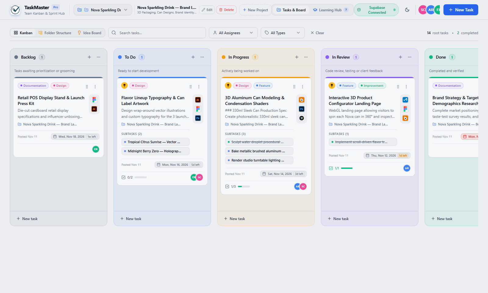
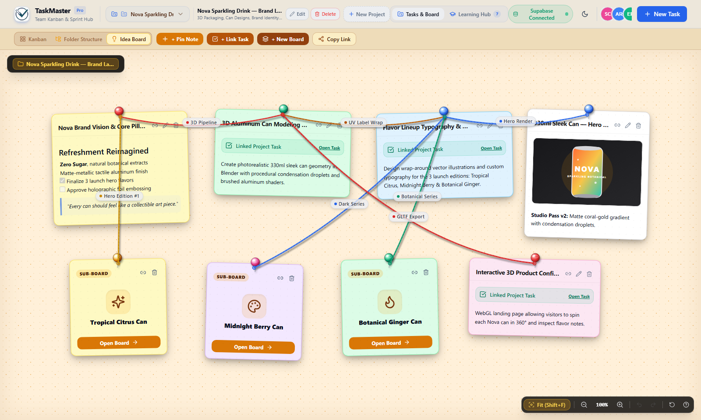
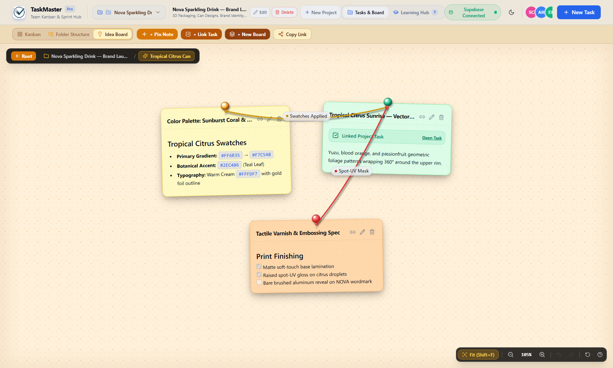
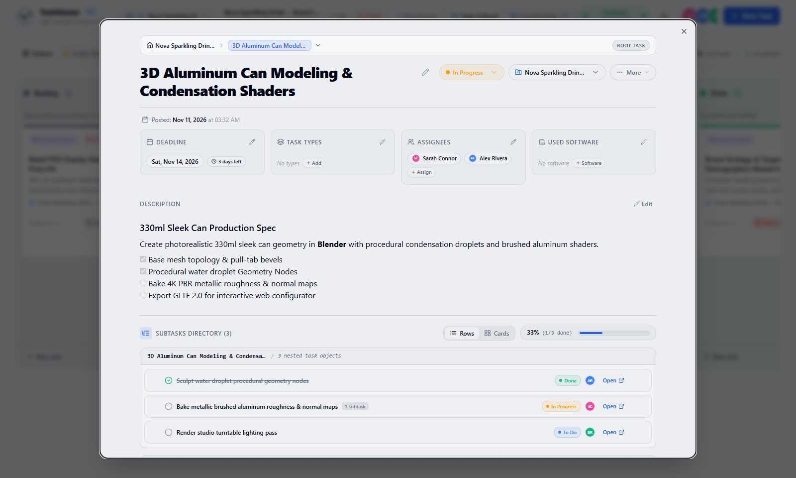
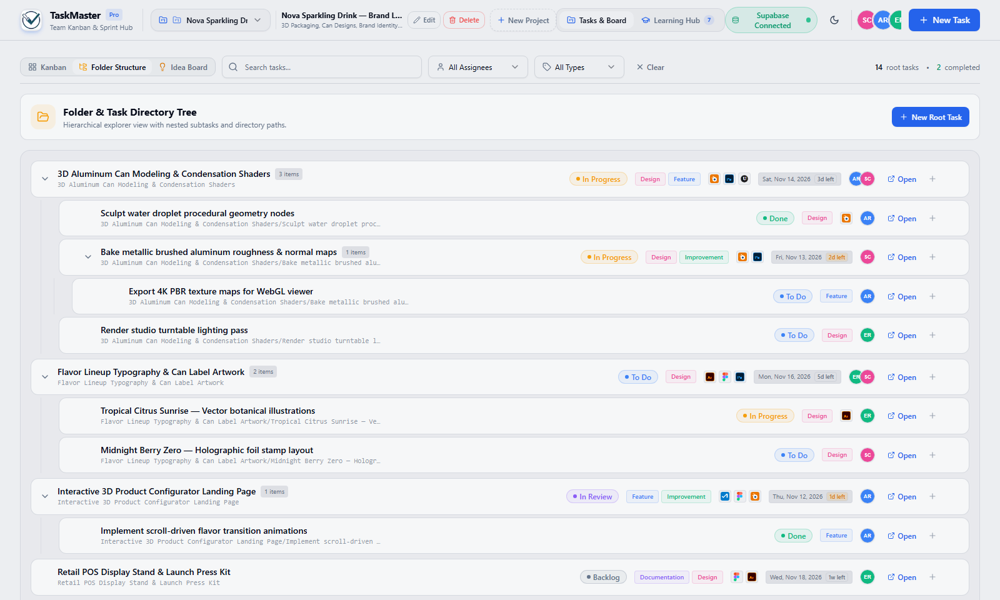
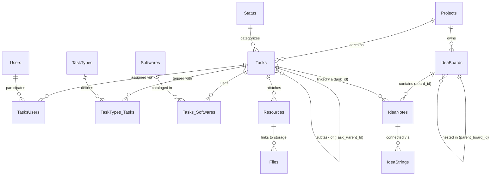

# TaskMaster 🚀

A full-featured, single-page **Project Management, Hierarchical Kanban, Detective Idea Board, and Learning Hub** application built with **Next.js 14 (App Router)**, **TypeScript**, **Tailwind CSS**, and **Supabase (PostgreSQL, Storage, & RLS)**.

TaskMaster is crafted for creative studios, product teams, and engineering workflows — combining recursive subtask trees, an interactive corkboard Idea Board with nested sub-boards and yarn connections, software stack tagging, and zero-config offline demo resilience.

---

## 📸 Application Showcase ("Nova Sparkling Drink — Brand Launch")

### 1. Kanban Board with Linked Idea Board Indicators & Software Stack
Tasks display their assigned software icons (Blender, Figma, Photoshop, Illustrator, VS Code, Unreal Engine), subtask completion progress, deadline badges, and a glowing **💡 Lightbulb Indicator** in the top-left corner whenever a task is linked to the Idea Board.



---

### 2. Interactive Corkboard Idea Board & Nested Sub-Boards
A full-bleed spatial canvas (`Middle-Click` or `Ctrl + Left Drag` to pan, cursor-centered `Scroll Wheel` zoom, `Shift + F` to fit all notes, marquee box multi-selection). Pin Markdown notes, images, videos, links, linked Kanban tasks, and **nested sub-idea boards** connected by realistic detective yarn strings that render on top of notes and dynamically become semi-transparent over any note you hover on.



---

### 3. Nested Sub-Idea Board with Hierarchy Breadcrumb Navigation
Double-clicking or clicking **Open Board** on any sub-board card drills into a dedicated child board (e.g., `Nova Sparkling Drink — Brand Launch / Tropical Citrus Can`) with instant breadcrumb navigation and a one-click `← Root` return button.



---

### 4. Rich Task Modal & Multi-Level Subtask Hierarchy
Auto-focuses the title field on creation, supports rich Markdown descriptions with inline attachment previews, interactive subtask creation and drag-reordering, software tool tagging, and full breadcrumb navigation across parent and child tasks.



---

### 5. Hierarchical Folder Explorer View
Browse projects, root tasks, and deeply nested subtasks like a file-system directory tree (`📁 Project / 📁 Task / 📄 Subtask`) with instant status updates and drill-down breadcrumbs.



---

## 📑 Table of Contents

- [Application Showcase](#-application-showcase-nova-sparkling-drink--brand-launch)
- [Core Functionalities](#-core-functionalities)
- [Tech Stack](#-tech-stack)
- [How to Run Locally](#-how-to-run-locally)
- [How to Connect to Supabase (Database & Storage)](#-how-to-connect-to-supabase-database--storage)
- [How to Host & Deploy on Vercel](#-how-to-host--deploy-on-vercel)
- [Keyboard Shortcuts & Canvas Controls](#-keyboard-shortcuts--canvas-controls)
- [Database Schema & Architecture](#-database-schema--architecture)
- [Project Directory Structure](#-project-directory-structure)
- [Troubleshooting & FAQs](#-troubleshooting--faqs)

---

## ✨ Core Functionalities

### 📋 Kanban Board & Task Management
- **Drag & Drop Workflow**: Smooth, collision-detected card and column reordering powered by `@dnd-kit` with optimistic UI updates.
- **Customizable Columns**: Create, rename, reorder, or recolor status columns using a 16-color palette or custom hex picker.
- **Recursive Subtasks**: Subtasks are full-fledged tasks with their own assignees, software tags, deadlines, attachments, and nested child subtasks.
- **Software Stack Tagging**: Tag tasks with production tools (Blender, Figma, Photoshop, Illustrator, Unreal Engine, VS Code, or custom uploaded transparent PNG/SVG icons).
- **Bidirectional Idea Board Linking**: Tasks linked to an Idea Board display a clickable **💡 lightbulb badge** on the Kanban card that jumps directly to the Idea Board and highlights the linked note.
- **Auto-Focused Creation**: Creating a new task, note, or sub-board automatically places the typing cursor in the title field for immediate keyboard entry.

### 📌 Detective Corkboard Idea Board
- **Full-Bleed Interactive Canvas**:
  - **Pan**: Hold `Middle Mouse Button` or `Ctrl + Left Click` and drag.
  - **Cursor-Centered Zoom**: Scroll the mouse wheel to zoom smoothly toward the exact cursor position.
  - **Fit to View (`Shift + F`)**: Automatically centers and scales the viewport to frame all notes and tasks on the current board.
  - **Marquee Box Selection**: Drag on the empty corkboard background to select multiple notes and move them together as a group.
- **Rich Note Types**:
  - **Markdown Notes**: Checklists, headings, blockquotes, and code blocks.
  - **Direct Drag & Drop Media**: Drag and drop images or web links directly from your desktop or browser onto the board to pin them immediately without modal popups.
  - **Linked Kanban Tasks (`+ Link Task`)**: Pin existing project tasks onto the corkboard with live status badges and a one-click **Open Task** button.
  - **Nested Idea Sub-Boards (`+ New Board`)**: Organize complex projects into nested sub-boards (e.g., *Main Brand Board* &rarr; *Tropical Citrus Can*, *Midnight Berry Can*, *Botanical Ginger Can*), displayed as square cards with top-center icons, titles, floating breadcrumb path navigation, and confirmation dialogs before deletion.
- **Detective Yarn Connections**:
  - Click a pushpin and click a target pushpin (or drag between pins) to tie a colored yarn string (`Detective Red`, `Natural Twine`, `Electric Blue`, `Forest Green`, `Golden Yarn`, `Neon Pink`).
  - Press `Esc` at any time to cancel an active connection string.
  - **Smart Hover Semi-Transparency**: Connection strings render visually **on top of** notes by default, and dynamically fade to semi-transparent over the exact region of any note you hover on so text and media underneath remain 100% readable and interactive.
- **Clipboard & History**:
  - **Undo / Redo (`Ctrl + Z` / `Ctrl + Y`)**: Works seamlessly on canvas actions (moving, creating, deleting, connecting notes) while preserving native text undo inside input fields and editors.
  - **Copy / Paste (`Ctrl + C` / `Ctrl + V`) & Duplicate (`Shift + D`)**: Quickly duplicate single or multiple selected notes.

### 📂 Folder Explorer & 🎓 Learning Hub
- **Folder Explorer View**: Navigate tasks and nested subtasks in a clean two-pane directory tree.
- **Education / Learning Hub**: Organize study groups, visual node connections, and tagged learning resources (tutorials, documentation, videos) linked directly to tasks.
- **Deep Linking**: Share direct URLs to any project (`?project=<id>`), view (`?view=ideas` or `?view=folder`), or specific task (`?task=<id>`).

---

## 🛠 Tech Stack

- **Framework**: [Next.js 14](https://nextjs.org/) (App Router)
- **Language**: [TypeScript](https://www.typescriptlang.org/)
- **Database & Storage**: [Supabase](https://supabase.com/) (PostgreSQL 15, Row Level Security, Storage Buckets)
- **Styling**: [Tailwind CSS](https://tailwindcss.com/) + `tailwindcss-animate`
- **UI Primitives**: [Radix UI](https://www.radix-ui.com/) / [shadcn/ui](https://ui.shadcn.com/)
- **Drag & Drop**: [`@dnd-kit/core`](https://dndkit.com/) & `@dnd-kit/sortable`
- **Markdown**: `react-markdown`, `remark-gfm`, `rehype-raw`
- **Icons**: [Lucide React](https://lucide.dev/)

---

## 💻 How to Run Locally

### Prerequisites
- **Node.js**: `v18.17+` (`v20+` LTS recommended)
- **npm** (or `pnpm` / `yarn`)
- **Git**

### Step 1: Clone the Repository
```bash
git clone https://github.com/your-username/TaskMaster.git
cd TaskMaster
```

### Step 2: Install Dependencies
```bash
npm install
```

### Step 3: Run in Instant Demo Mode (Zero Configuration Required)
TaskMaster includes a built-in **Demo & Local Persistence Mode** pre-loaded with the **"Nova Sparkling Drink — Brand Launch"** showcase project, tasks, subtasks, and nested Idea Boards. You can run it immediately without setting up a database:

```bash
npm run dev
```

Open **[http://localhost:3000](http://localhost:3000)** in your browser.

---

## 🗄 How to Connect to Supabase (Database & Storage)

To persist all projects, tasks, subtasks, file attachments, and Idea Boards in the cloud with PostgreSQL and Supabase Storage, follow these steps:

### Step 1: Create a Supabase Project
1. Sign in to the [Supabase Dashboard](https://supabase.com/dashboard).
2. Click **"New Project"**, choose your organization, enter a project name (e.g., `TaskMaster`), set a strong database password, and select your closest region.
3. Wait ~1–2 minutes for your PostgreSQL database to finish provisioning.

### Step 2: Run the Database Schema & Idea Board Migrations
1. In your Supabase Dashboard, open the **SQL Editor** from the left sidebar (`>_` icon) and click **"New query"**.
2. **Core Schema**:
   - Open [`supabase/schema.sql`](supabase/schema.sql) from this repository.
   - Copy its entire contents into the Supabase SQL Editor and click **Run**.
   - This creates all core tables (`Projects`, `Status`, `Tasks`, `TaskTypes`, `Users`, `Softwares`, `Resources`, `Files`, `StudyGroups`, `EducationalMaterials`), foreign-key cascades, RLS policies, and the `task-attachments` storage bucket.
3. **Idea Board & Nested Sub-Boards Schema**:
   - Click **"New query"** in the SQL Editor again.
   - Open [`supabase/idea_board_migration.sql`](supabase/idea_board_migration.sql) from this repository.
   - Copy its entire contents into the SQL Editor and click **Run**.
   - This creates `IdeaBoards` (with recursive `parent_board_id` for nested sub-boards), `IdeaNotes` (with `board_id`, `sub_board_id`, and `task_id`), `IdeaStrings`, and the `idea-attachments` storage bucket.

### Step 3: Configure `.env.local`
1. Copy the example environment file in the project root:
   ```bash
   # macOS / Linux
   cp .env.example .env.local

   # Windows (PowerShell)
   Copy-Item .env.example .env.local
   ```
2. In your Supabase Dashboard, navigate to **Project Settings (⚙️) &rarr; API**.
3. Copy your **Project URL** and **`anon` `public` API key** into `.env.local`:
   ```env
   NEXT_PUBLIC_SUPABASE_URL=https://your-project-ref.supabase.co
   NEXT_PUBLIC_SUPABASE_ANON_KEY=eyJhbGciOiJIUzI1NiIsInR5cCI6IkpXVCJ9...
   ```
4. Restart the development server:
   ```bash
   npm run dev
   ```
   The top navigation bar will switch from **Demo Mode** to **Connected** and sync your boards with Supabase!

---

## 🌐 How to Host & Deploy on Vercel

Deploying TaskMaster to production on [Vercel](https://vercel.com/) takes less than 2 minutes:

### Step 1: Push Your Repository to GitHub
Ensure your latest code is pushed to a GitHub, GitLab, or Bitbucket repository:
```bash
git add .
git commit -m "Ready for Vercel deployment"
git push origin main
```

### Step 2: Import the Project in Vercel
1. Go to [vercel.com/new](https://vercel.com/new) and sign in with your GitHub account.
2. Click **"Import"** next to your `TaskMaster` repository.
3. Vercel will automatically detect **Next.js** as the framework preset:
   - **Build Command**: `next build` (default)
   - **Output Directory**: `.next` (default)
   - **Install Command**: `npm install` (default)

### Step 3: Add Environment Variables in Vercel
Expand the **"Environment Variables"** section before deploying (or in **Project Settings &rarr; Environment Variables**) and add your Supabase credentials:

| Name | Value | Environment |
|---|---|---|
| `NEXT_PUBLIC_SUPABASE_URL` | `https://your-project-ref.supabase.co` | Production, Preview, Development |
| `NEXT_PUBLIC_SUPABASE_ANON_KEY` | `eyJhbGciOiJIUzI1NiIsInR5cCI6IkpXVCJ9...` | Production, Preview, Development |

*(Note: If you deploy without setting these variables, the Vercel deployment will still build and run cleanly in interactive Demo Mode).*

### Step 4: Deploy
1. Click **"Deploy"**.
2. Wait ~45–60 seconds for Vercel to build and optimize the Next.js bundle.
3. Once finished, Vercel will provide your live production URL (e.g., `https://taskmaster-yourname.vercel.app`).

---

## ⌨️ Keyboard Shortcuts & Canvas Controls

| Shortcut / Action | Context | Description |
|---|---|---|
| `Middle Mouse Drag` or `Ctrl + Left Drag` | Idea Board | Pan smoothly around the corkboard canvas |
| `Mouse Wheel` | Idea Board | Zoom in/out centered directly on the mouse cursor |
| `Shift + F` | Idea Board | Fit and center the viewport on all notes/tasks |
| `Left Drag on Background` | Idea Board | Box-select (marquee) multiple notes at once |
| `Ctrl + C` / `Ctrl + V` | Idea Board | Copy and paste selected note(s) |
| `Shift + D` | Idea Board | Instantly duplicate selected note(s) |
| `Ctrl + Z` / `Ctrl + Y` | Idea Board & Text Fields | Undo / Redo canvas changes (or text edits when focused in an input) |
| `Delete` / `Backspace` | Idea Board | Delete selected note(s) or selected yarn connection |
| `Esc` | Idea Board | Cancel active pin connection string or deselect |
| `Double-Click Corkboard` | Idea Board | Open modal to pin a new note at cursor coordinates |
| `Double-Click Sub-Board` | Idea Board | Open the nested sub-idea board |

---

## 🏗 Database Schema & Architecture



---

## 📁 Project Directory Structure

```text
TaskMaster/
├── public/
│   ├── logo.png                        # Application brand logo
│   └── screenshots/                    # Application showcase screenshots
│       ├── kanban-board.png
│       ├── idea-board-main.png
│       ├── idea-board-subboard.png
│       ├── task-modal-subtasks.png
│       └── folder-explorer.png
├── src/
│   ├── app/
│   │   ├── globals.css                 # Tailwind CSS & custom scrollbar styles
│   │   ├── layout.tsx                  # Root layout & ThemeProvider
│   │   └── page.tsx                    # Main SPA controller & URL router
│   ├── components/
│   │   ├── education/                  # Learning Hub & Study Groups views
│   │   ├── explorer/                   # Hierarchical Folder Explorer view
│   │   ├── filters/                    # Project, Assignee, Tag & Idea Board toolbar
│   │   ├── idea-board/                 # Corkboard Canvas, Notes, Yarn Strings & Modals
│   │   ├── kanban/                     # KanbanBoard, KanbanColumn, KanbanCard
│   │   ├── navbar/                     # Top navigation, view switcher & status badge
│   │   ├── projects/                   # Project creation & management modals
│   │   ├── tasks/                      # TaskModal, Subtasks, FileUploader, Breadcrumbs
│   │   └── ui/                         # Reusable Radix UI / shadcn components
│   ├── lib/
│   │   ├── supabase/                   # Supabase client, server actions & demo state
│   │   ├── idea-board-storage.ts       # Idea Board local cache & Supabase cloud sync
│   │   └── utils.ts                    # Class merge & formatting helpers
│   └── types/
│       ├── database.types.ts           # Core database & entity TypeScript interfaces
│       └── idea-board.types.ts         # Idea Board, Note, Sub-Board & String types
├── supabase/
│   ├── schema.sql                      # Core PostgreSQL tables, RLS & seed data
│   └── idea_board_migration.sql        # IdeaBoards, IdeaNotes, IdeaStrings & storage
├── .env.example                        # Environment variable template
├── next.config.mjs                     # Next.js configuration
├── package.json                        # Scripts & dependencies
└── tsconfig.json                       # TypeScript configuration
```

---

## ❓ Troubleshooting & FAQs

### 1. Supabase project paused / connection timeout
- **Cause**: Free-tier Supabase projects pause after 7 days of inactivity.
- **Fix**: Open your [Supabase Dashboard](https://supabase.com/dashboard) and click **"Restore project"**. Until restored, TaskMaster automatically falls back to local Demo Mode so your workflow is never blocked.

### 2. Missing Idea Board tables (`IdeaBoards`, `IdeaNotes`, `IdeaStrings`)
- **Cause**: Only `supabase/schema.sql` was executed.
- **Fix**: Run [`supabase/idea_board_migration.sql`](supabase/idea_board_migration.sql) in the Supabase SQL Editor to create the Idea Board tables and nested sub-board columns.

---

## 📄 License

This project is open-source and available under the [MIT License](LICENSE).
